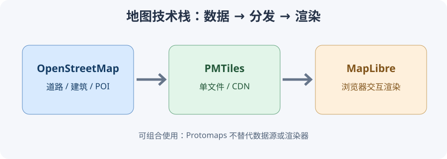
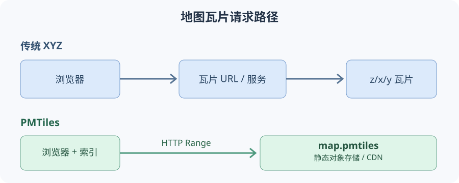
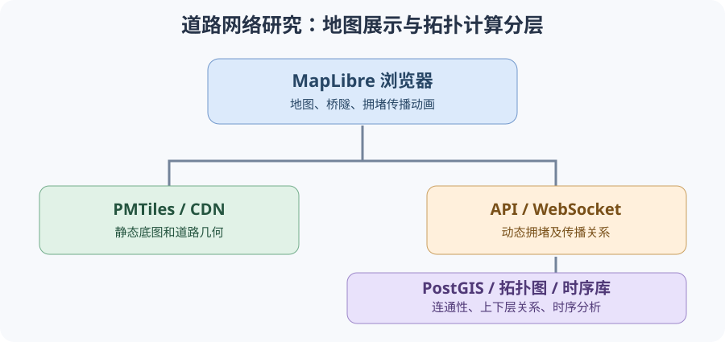

# Protomaps 与其它地图技术有什么不同？

> **核心结论：** Protomaps 将地图瓦片打包成可按 HTTP Range 请求读取的 PMTiles 归档，让对象存储和 CDN 就能提供地图瓦片数据。它解决的是地图数据的**打包、分发和部署**问题，不是 Google Maps、OpenStreetMap 或 MapLibre 的完整替代品。

*整理日期：2026-11-16*



## 1. 首先分清：地图数据、渲染与托管

| 技术 | 主要角色 | 典型能力 |
|---|---|---|
| **OpenStreetMap（OSM）** | 开放地理数据 | 道路、建筑、地点及属性 |
| **Google Maps Platform** | 综合商业地图服务 | 地图、地址搜索、路线规划等 |
| **Mapbox** | 地图平台及托管服务 | 矢量地图、样式、SDK、地图 API |
| **MapLibre GL JS** | 浏览器渲染引擎 | 矢量瓦片绘制、交互、样式 |
| **Leaflet** | 浏览器地图库 | 地图交互及图层组织 |
| **MBTiles** | SQLite 瓦片归档格式 | 单文件离线地图与瓦片数据管理 |
| **Protomaps / PMTiles** | 地图瓦片归档与分发 | 单文件、HTTP Range、静态托管 |

这些技术可以共同工作。例如：**OSM 数据 → Protomaps 矢量底图 / PMTiles 文件 → 对象存储 → MapLibre 渲染**。

## 2. 核心变化：从 XYZ 瓦片到单个 PMTiles 文件



传统 XYZ 地图通过 `z/x/y` 表示缩放级别与瓦片坐标，浏览器可请求：

```text
https://tiles.example.com/12/3372/1552.pbf
```

后台既可以使用动态瓦片服务器，也可以是预生成的静态瓦片目录。**XYZ 并不天然意味着必须部署动态服务器。**

PMTiles 把大量瓦片及其索引打包为一个文件。浏览器读取文件头和索引，计算目标瓦片在文件中的字节区间，再发出 HTTP Range 请求：

```http
GET /region.pmtiles HTTP/1.1
Range: bytes=1000000-1004095
```

这只请求 4096 字节，而不是下载整个世界地图。托管服务必须正确支持字节范围请求；跨域使用还需要恰当的 CORS 配置。


这是**只读、以远程随机访问为目标优化的瓦片归档**。PMTiles v3 包含文件头、目录索引、元数据和瓦片数据等组成部分；图中比例仅为示意。

## 3. PMTiles 与 MBTiles

| 指标 | MBTiles | PMTiles |
|---|---|---|
| 基础格式 | SQLite 数据库 | 专用只读二进制归档 |
| 单文件封装 | 是 | 是 |
| 矢量瓦片 | 支持 | 支持 |
| 本地访问 | 方便 | 方便 |
| 浏览器直接使用对象存储上的单文件 | 通常需要服务层/转换 | 设计目标之一 |
| 原地更新 | 可以通过 SQLite 修改 | 通常需要重新构建 |
| 典型场景 | 离线应用、瓦片后端 | CDN、静态托管、按需读取 |

**关键取舍：** PMTiles 用不可变归档简化远程读取和缓存，但不适合作为高频动态数据的可更新数据库。

## 4. 为什么成本可能更低？

如果使用单个 PMTiles 文件及 CDN，就不一定需要独立运行瓦片服务器、数据库和缓存服务。成本更接近对象存储费用、HTTP 请求费用和实际传输流量。

[原文](https://bruceroettgers.eu/blog/protomaps/) 用 Bunny.net 举例：约 139 GB 的全球底图、约 5 美元/月存储费、单次地图访问约 5 MB 流量，按案例价格推算约 0.05 美元/千次加载的流量费。

**注意：** 这只是原作者在特定地区、CDN 和访问方式下的估算，不是 Protomaps 的统一价格。地图生成/更新、缓存失效、请求次数和运营成本都可能改变实际支出；与商业地图 API 也不一定是等功能比较。

## 5. 在 GitHub Pages 使用 Protomaps

GitHub Pages 很适合托管**这篇说明文章和 SVG 插图**。小型 PMTiles 也可测试，但全球地图文件通常太大，不宜直接纳入 Pages 仓库。更常见的组合是：

```text
GitHub Pages：网页、JavaScript、地图样式
对象存储/CDN：region.pmtiles
MapLibre + pmtiles.js：浏览器按需读取、渲染
```

MapLibre 里注册 PMTiles 协议的基础代码如下（仍需完整样式和图层配置）：

```js
import maplibregl from 'maplibre-gl';
import { Protocol } from 'pmtiles';

const protocol = new Protocol();
maplibregl.addProtocol('pmtiles', protocol.tile);

const source = {
  type: 'vector',
  url: 'pmtiles://https://cdn.example.org/region.pmtiles'
};
```

这里的 `cdn.example.org` 是占位域名。完整方法请参考 [MapLibre 集成文档](https://docs.protomaps.com/pmtiles/maplibre)。

## 6. 应用于道路网络三维拓扑和拥堵传播研究



建议把三个系统分开：

1. **静态地图分发：** 采用 PMTiles/CDN 提供底图、道路几何及适合瓦片化的属性；
2. **动态时序数据：** 使用 API / WebSocket 传输路段拥堵向量、传播状态、时滞依赖等动态结果；
3. **可计算拓扑：** 使用 PostGIS 或专用图结构保存道路方向、连通性、桥隧上下层关系和空间查询能力。

对于立交桥，**2D 几何相交不等于路网拓扑连通**。矢量瓦片可显示桥梁、隧道和层级属性，但复杂的、可编辑的三维路网拓扑不应仅依赖地图瓦片管理。

## 7. 局限与结论

Protomaps 并不直接提供实时路况、导航、路线规划、地理编码或复杂空间分析。频繁改变的瓦片也不适合不断重新构建大型只读 PMTiles 文件。

它的价值在于：**把地图发布与分发简化为“PMTiles 文件 + 支持 HTTP Range 的存储/CDN + 兼容的浏览器渲染器”**。是否能替换现有方案，应分别考察地图数据质量、更新频率、托管成本和附加服务。

## 参考资料

- [Bruce Röttgers：Self-hosting map tiles has gotten cheap and easy](https://bruceroettgers.eu/blog/protomaps/)
- [Protomaps 官方文档](https://docs.protomaps.com/)
- [PMTiles 概念与格式](https://docs.protomaps.com/pmtiles/)
- [MapLibre 与 PMTiles](https://docs.protomaps.com/pmtiles/maplibre)
- [Protomaps Basemap](https://docs.protomaps.com/basemaps/)
- [Cloud Storage / 静态托管](https://docs.protomaps.com/pmtiles/cloud-storage)

*示意图为本文绘制。实际使用 OSM 衍生地图数据时，应按许可证要求提供署名。*
